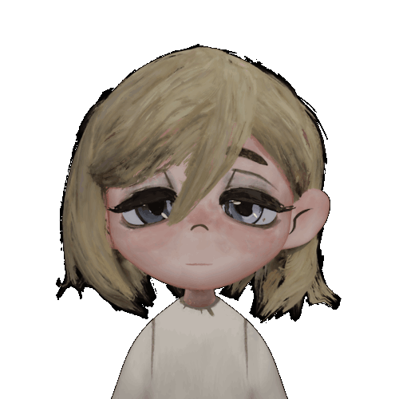
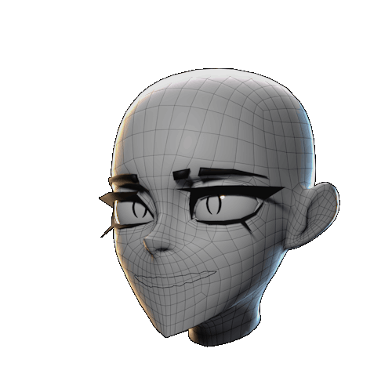
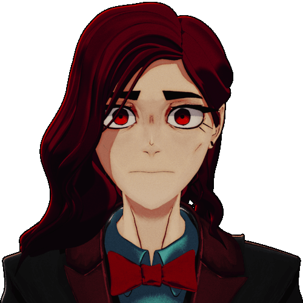
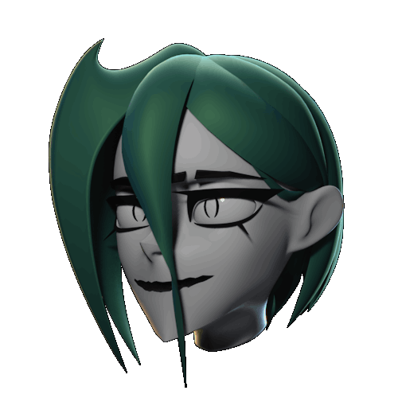

# Core Concepts

Since SMIRK is still a more intermediate, manual tool and in order to make it's features more digestible I decided to make a little "glossary" explaining the core features and ideas of the addon.

## [Freeform Facial Features](freeform-facial-features.md#freeform-facial-features){ data-preview }
---

- ## :custom-surface: **[Surface Object](surface-object.md#surface-object){ data-preview }**

	 ---
	 
	 
- ## :fontawesome-solid-scissors: **[Cutter](cutter.md#cutter){ data-preview }**

	 ---
	  
	  
- ## :material-transition-masked: **[Mask](mask.md#cutter-mask){ data-preview }**

	 ---
	  
	 
- ## :custom-modifier: **[Modifier](modifier.md#modifier){ data-preview }**

	 ---
	  
	
