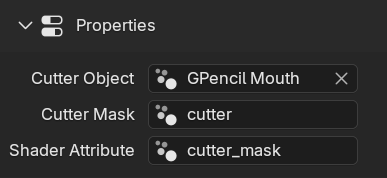

# Cutter Mask

The Cutter Mask or just Mask is used to determine what part of the Cutter is actually used to generate the hole through various means like transparency, cutout or boolean.

This is done either through a Vertex Group for Meshes or a Grease Pencil Layer.

Setting up an instance of SMIRK will ask you to name the Cutter Mask which will create a corresponding Vertex Group or GP Layer depending on the object chosen

{align=right width="300"}
You can also manually setup the Mask yourself.
Just make sure the name of the Mask in the properties tab corresponds to the Attribute you've created. 
Regarding the example on the right that would be either a vertex group or layer called _"cutter_mask"_

