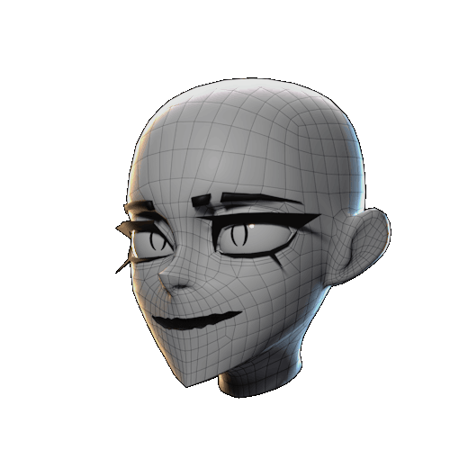

# Surface Object

{align=right width="200"} The Surface Object is the main object that SMIRK will operate on. It's where the [Mask](mask.md#mask){ data-preview } and subsequent hole gets generated. 
In most cases this will be the head of your character.

SMIRK comes with an arsenal of tools that will help setup FFF on your Surface Object.