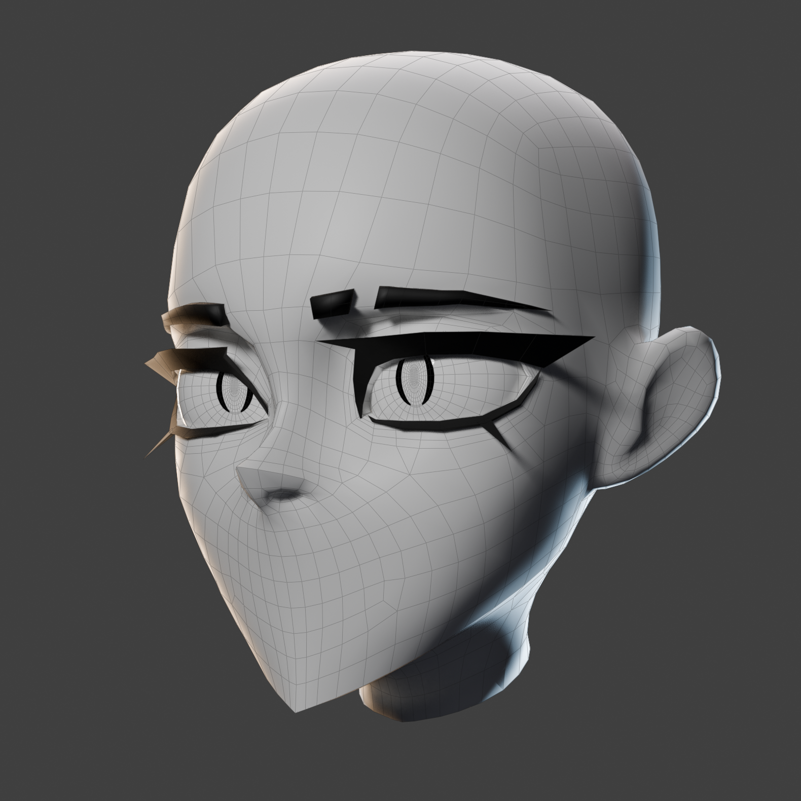
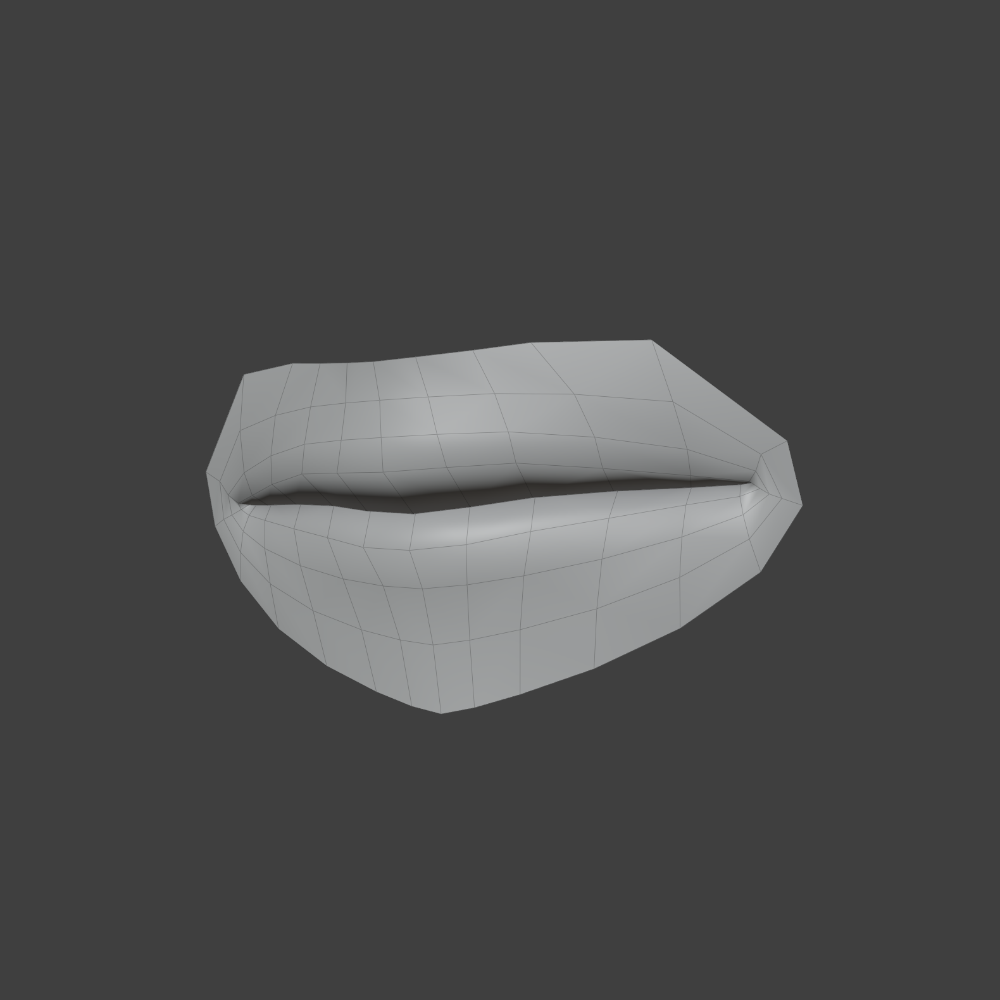
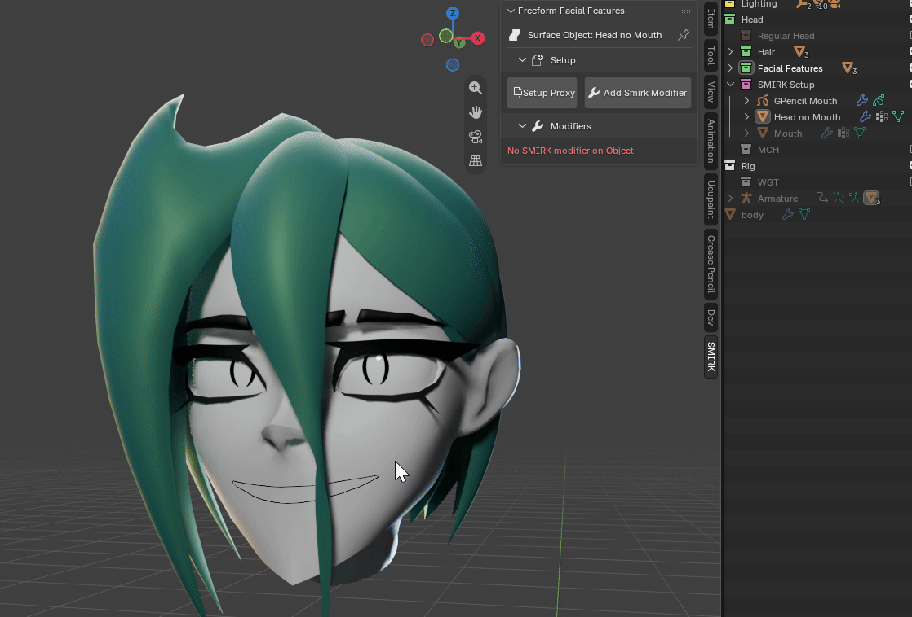

# Setup

SMIRK follows a general setup workflow that then changes and becomes more flexible depending on the type of facial feature you're trying to implement

This setup will tackle the most general use case of SMIRK: A mouth setup

You will need two objects, the [Surface Object](../core-concepts/surface-object.md) and the [Cutter Object](../core-concepts/cutter.md)
The surface will be your head and the cutter will be the mouth. 

---

{align=right width="200"} The head should have no mouth modeled in. It should be an even, flat surface for best results. Having the head separated from the body can help with performance but is not necessary. If you want to make use of the Manifold Boolean cutting behavior you should make sure the surface object is manifold as well. Roughly speaking this means no inner edges, holes in the mesh or floating vertices and edges. N-Gons and intersections in the mesh are fine.

---

{align=right width="200"} The cutter object will be your mouth. It can be a simple ribbon (edge loop), detached mouth or grease pencil.
Look at the specific **facial feature**  for their individual setups

---
## Setup Proxy

Go to the SMIRK Panel on the side of the 3D View and click {==Setup Proxy==} after selecting the surface object. This creates a [proxy](../core-concepts/proxy-object.md) of the object which is essentially a linked duplicate of the head. It shares all necessary properties and is needed to prevent dependency cycles from happening